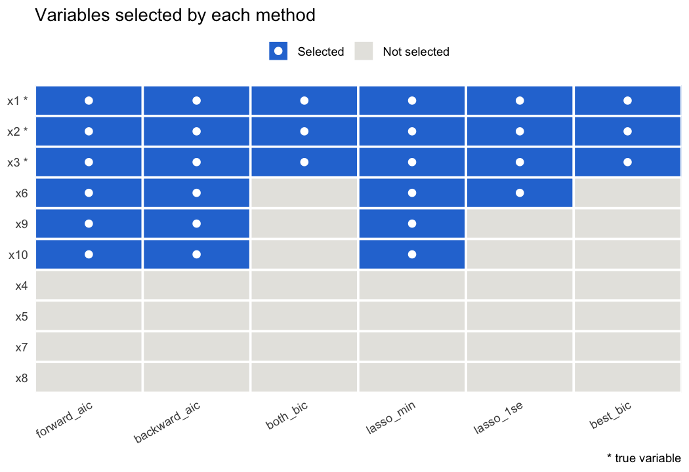
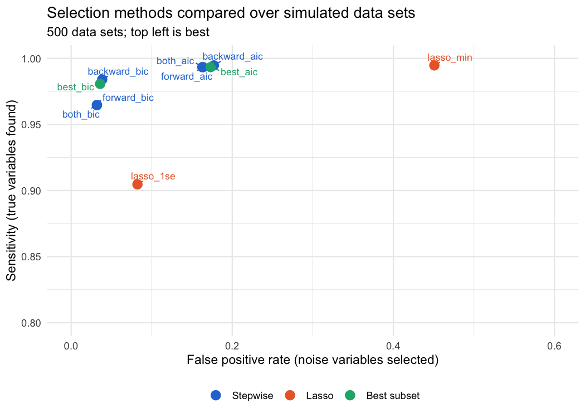

<!-- README.md is generated from README.Rmd. Edit README.Rmd, then run devtools::build_readme(). -->

# selectbench

**selectbench runs several variable selection methods on the same data,
shows which variables each one picks, and scores the methods against the
truth on simulated data.**

## The problem it solves

Suppose you have an outcome and ten possible predictors, and you want to
know which predictors to keep in the model. Variable selection methods
answer this question automatically, but different methods give different
answers on the same data. Choosing one method and reporting its answer
hides that.

selectbench puts the answers side by side. The data below are simulated
so that only `x1`, `x2` and `x3` affect the outcome `y`. The other seven
variables are noise.

``` r
library(selectbench)

result <- compare_selection(y ~ ., data = selection_demo, seed = 1)
result
#> Variable selection on 200 rows, 10 variables (family: gaussian)
#> 
#>  variable forward_aic backward_aic both_bic lasso_min lasso_1se best_bic
#>  x1       x           x            x        x         x         x       
#>  x2       x           x            x        x         x         x       
#>  x3       x           x            x        x         x         x       
#>  x6       x           x            .        x         x         .       
#>  x9       x           x            .        x         .         .       
#>  x10      x           x            .        x         .         .       
#>  x4       .           .            .        .         .         .       
#>  x5       .           .            .        .         .         .       
#>  x7       .           .            .        .         .         .       
#>  x8       .           .            .        .         .         .       
#>  n_methods
#>  6        
#>  6        
#>  6        
#>  4        
#>  3        
#>  3        
#>  0        
#>  0        
#>  0        
#>  0        
#> 
#> Variables selected: forward_aic = 6, backward_aic = 6, both_bic = 3, lasso_min = 6, lasso_1se = 4, best_bic = 3
```

Every method found `x1`, `x2` and `x3`. Four of the six also picked up
noise variables: forward AIC, backward AIC and the lasso at its smallest
penalty picked three each, and the lasso at one standard error picked
one. Only the two BIC based methods found exactly the true variables.
The same table as a plot, with the true variables marked by a star:

``` r
plot(result, truth = c("x1", "x2", "x3"))
```



When you use your own data you will not know the truth. What you can see
is which variables every method agrees on and which ones depend on the
method chosen. When you do know the truth, as in a simulation,
`score_selection()` and `simulate_selection()` tell you which method
does best.

## Functions

| Function | What it does |
|----|----|
| `compare_selection()` | Runs the selection methods on your data and returns a table of which variable each method selected |
| `plot()` on its result | Draws that table, with the most widely selected variables at the top |
| `simulate_selection_data()` | Generates data in which you choose the true variables |
| `score_selection()` | For one comparison with a known truth, counts the true variables found and the noise variables picked |
| `simulate_selection()` | Repeats the whole experiment over many simulated data sets and averages the scores |
| `plot()` on its result | Plots every method by how many true variables it finds and how many noise variables it picks |

## Installation

Install the package from GitHub:

``` r
# install.packages("pak")
pak::pak("Jimmuji/selectbench")
```

Then load it:

``` r
library(selectbench)
```

## How to use it

### 1. Compare methods on your data

Give `compare_selection()` a formula and a data frame, the same way you
would for `lm()`.

``` r
compare_selection(mpg ~ ., data = mtcars, seed = 1)
#> Variable selection on 32 rows, 10 variables (family: gaussian)
#> 
#>  variable forward_aic backward_aic both_bic lasso_min lasso_1se best_bic
#>  wt       x           x            x        x         x         x       
#>  cyl      x           .            x        x         x         .       
#>  hp       x           .            .        x         x         .       
#>  am       .           x            .        x         .         x       
#>  qsec     .           x            .        .         .         x       
#>  disp     .           .            .        .         .         .       
#>  drat     .           .            .        .         .         .       
#>  vs       .           .            .        .         .         .       
#>  gear     .           .            .        .         .         .       
#>  carb     .           .            .        .         .         .       
#>  n_methods
#>  6        
#>  4        
#>  3        
#>  3        
#>  2        
#>  0        
#>  0        
#>  0        
#>  0        
#>  0        
#> 
#> Variables selected: forward_aic = 3, backward_aic = 3, both_bic = 2, lasso_min = 4, lasso_1se = 3, best_bic = 3
```

Rows with a missing value in any variable that is used are dropped
first, so that every method sees the same data. The `seed` makes the
result the same every time. It matters for the lasso, which chooses its
penalty by randomly splitting the data.

For a yes or no outcome, use `family = "binomial"`. The outcome can be 0
and 1, `TRUE` and `FALSE`, or a factor with two levels.

### 2. Choose the methods

``` r
compare_selection(y ~ ., data = selection_demo,
                  methods = c("both_aic", "both_bic", "lasso_1se"), seed = 1)$table
#>    variable both_aic both_bic lasso_1se
#> 1        x1     TRUE     TRUE      TRUE
#> 2        x2     TRUE     TRUE      TRUE
#> 3        x3     TRUE     TRUE      TRUE
#> 4        x4    FALSE    FALSE     FALSE
#> 5        x5    FALSE    FALSE     FALSE
#> 6        x6     TRUE    FALSE     FALSE
#> 7        x7    FALSE    FALSE     FALSE
#> 8        x8    FALSE    FALSE     FALSE
#> 9        x9     TRUE    FALSE     FALSE
#> 10      x10     TRUE    FALSE     FALSE
```

| Method | What it does |
|----|----|
| `forward_aic`, `forward_bic` | Forward stepwise. Starts with no predictors and adds the one that improves the criterion most, until nothing improves it |
| `backward_aic`, `backward_bic` | Backward stepwise. Starts with all predictors and removes the least useful one at a time |
| `both_aic`, `both_bic` | Stepwise in both directions. Starts with no predictors, and can also remove a variable it added earlier |
| `lasso_min` | The lasso, with the penalty that gives the smallest error in cross-validation. A variable is selected if its coefficient is not zero |
| `lasso_1se` | The lasso, with the largest penalty whose error is within one standard error of the smallest. Selects fewer variables |
| `best_aic`, `best_bic` | Best subset. Checks every combination of variables and picks the best one by AIC or BIC. Linear models only, up to 25 predictor columns |

AIC and BIC both reward a model that fits well and penalise one that has
many variables. BIC penalises more, so it keeps fewer variables.

A categorical variable with several levels is turned into several
columns. It counts as selected if any of its columns is, so each row of
the table is one variable from your formula.

### 3. Score the methods when you know the truth

Use `simulate_selection_data()` to make data in which you decide which
variables matter. The first `length(beta)` variables have the effects in
`beta`, and the rest are noise.

``` r
set.seed(10)
d <- simulate_selection_data(n = 100, p = 10, beta = c(1, -0.8, 0.6), rho = 0.5)
attr(d, "truth")
#> [1] "x1" "x2" "x3"

one <- compare_selection(y ~ ., d, seed = 1)
score_selection(one, truth = attr(d, "truth"))
#>         method n_selected true_found missed false_selected sensitivity
#> 1  forward_aic          5          3      0              2           1
#> 2 backward_aic          5          3      0              2           1
#> 3     both_bic          3          3      0              0           1
#> 4    lasso_min          7          3      0              4           1
#> 5    lasso_1se          3          3      0              0           1
#> 6     best_bic          3          3      0              0           1
#>   false_positive_rate exact
#> 1           0.2857143 FALSE
#> 2           0.2857143 FALSE
#> 3           0.0000000  TRUE
#> 4           0.5714286 FALSE
#> 5           0.0000000  TRUE
#> 6           0.0000000  TRUE
```

`sensitivity` is the share of true variables that were found.
`false_positive_rate` is the share of noise variables that were picked.
`exact` is `TRUE` when the method picked the true variables and nothing
else.

### 4. Repeat it many times

One data set can favour a method by luck. `simulate_selection()` repeats
the experiment on many simulated data sets and averages the scores. The
example below uses weak effects, a sample of 100 and correlated
predictors, which is a hard case.

``` r
sim <- simulate_selection(
  n = 100, p = 10, beta = c(0.8, -0.6, 0.5), rho = 0.5,
  methods = c("forward_aic", "backward_aic", "both_aic", "forward_bic",
              "backward_bic", "both_bic", "lasso_min", "lasso_1se",
              "best_aic", "best_bic"),
  n_sim = 500, seed = 2025
)
sim
#> Simulation: 500 data sets, n = 100, p = 10, 3 true variable(s), rho = 0.5, family: gaussian
#> 
#>        method sensitivity false_positive_rate exact mcse_exact n_selected
#>   forward_aic       0.993               0.164 0.302      0.021      4.126
#>  backward_aic       0.995               0.177 0.274      0.020      4.224
#>      both_aic       0.993               0.163 0.302      0.021      4.120
#>   forward_bic       0.965               0.032 0.754      0.019      3.118
#>  backward_bic       0.984               0.039 0.758      0.019      3.222
#>      both_bic       0.965               0.032 0.754      0.019      3.118
#>     lasso_min       0.995               0.451 0.040      0.009      6.140
#>     lasso_1se       0.905               0.082 0.408      0.022      3.290
#>      best_aic       0.993               0.173 0.280      0.020      4.192
#>      best_bic       0.981               0.036 0.762      0.019      3.194
```

`exact` is the share of the 500 data sets in which the method found
exactly the three true variables. `mcse_exact` is the Monte Carlo
standard error of that share, which says how much of the difference
between two methods could be chance.

``` r
plot(sim)
```



A method in the top left corner finds the true variables without picking
up noise. In this setting the BIC methods and best subset with BIC have
the fewest noise variables, the AIC methods find slightly more true
variables at the cost of more noise, and the lasso at its smallest
penalty picks up the most noise.

Every data set is generated with the seed `seed + i`, so the result is
the same each time and does not depend on the number of cores used.

## Limits

- Best subset is only available for linear models, and for at most 25
  predictor columns.
- Only main effects are supported, not interactions.
- The outcome must be a single column.

## How it differs from other packages

[`StepReg`](https://cran.r-project.org/package=StepReg) runs several
stepwise strategies and criteria in one call, and
[`featR`](https://cran.r-project.org/package=featR) puts many feature
selection methods behind one interface. Neither one lays out the
selections of different methods in one comparison table or plot, and
neither scores the methods against a known truth. selectbench does both,
and repeats the scoring over simulated data sets.

## Getting help

Every function and the example data have a help page with examples:

``` r
?compare_selection
?simulate_selection
help(package = "selectbench")
```

## Authors

Jim Wang. Written as a project for CHL5233H, Statistical Programming and
Computation for Health Data, at the University of Toronto.

## License

MIT
